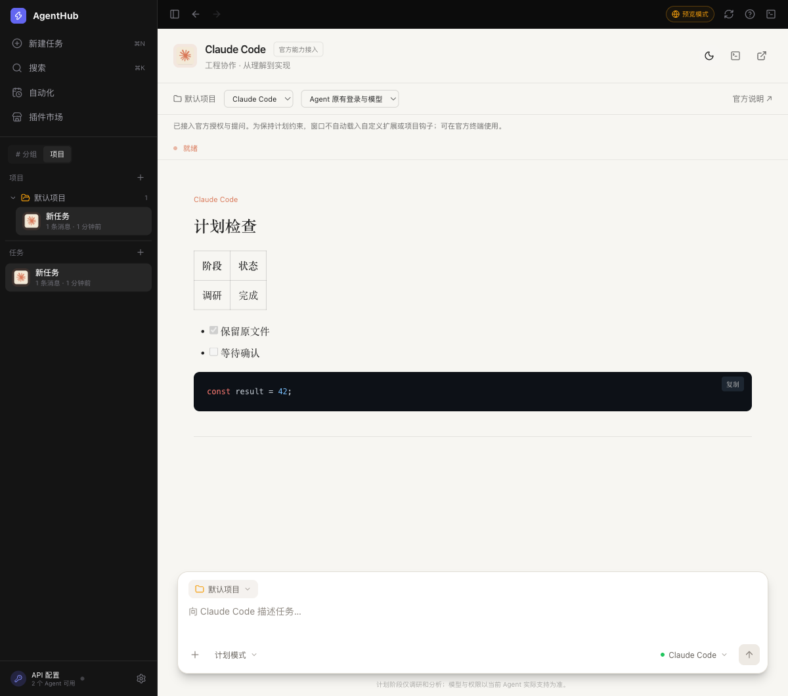
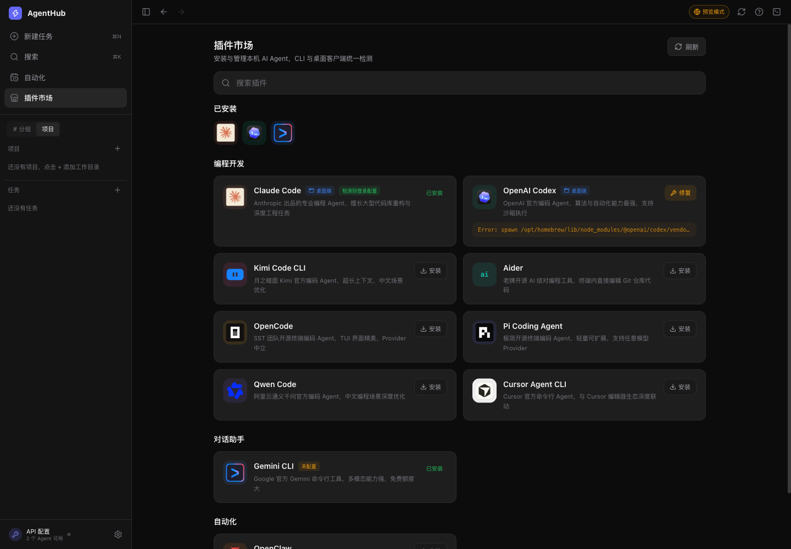
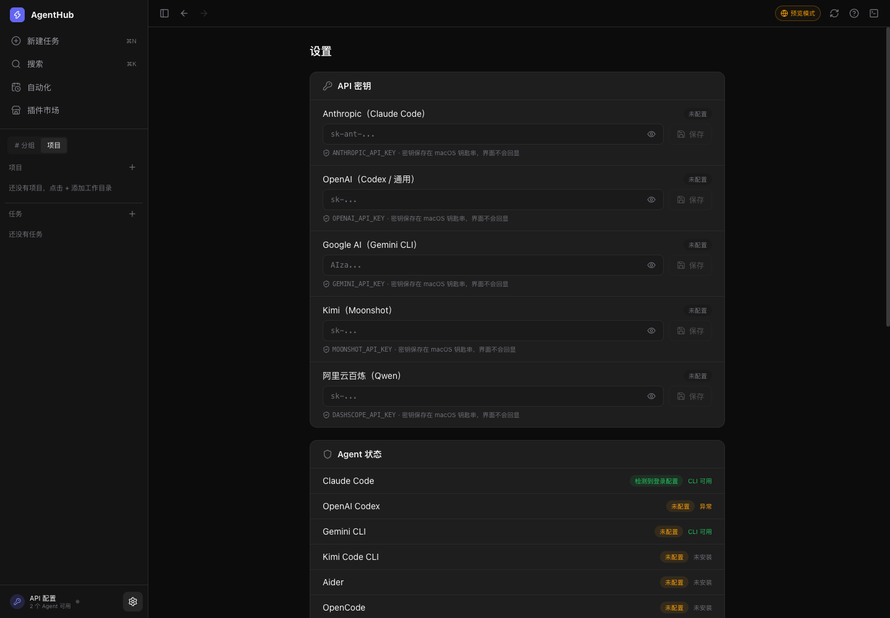

# AgentHub

<p align="center">
  
</p>

<p align="center">
  A macOS workspace for managing AI coding assistants, organizing tasks by project, reviewing plans, and resuming earlier sessions.
</p>

<p align="center">
  English · <a href="README.md">简体中文</a>
</p>

<p align="center">
  
  
  <a href="LICENSE"></a>
</p>

> [!IMPORTANT]
> The v0.5.0 source is available here. Build the desktop app locally on macOS.

## Quick downloads

| Platform | Recommended download | Installation |
| --- | --- | --- |
| macOS (tested on Apple silicon) | [Download the source ZIP](https://github.com/Jessica-yaoyao/AgentHub/archive/refs/heads/main.zip) | [Build from source](#installation-notes) |

## Preview

> The screenshots show the v0.5.0 interface demo with sample tasks, installation statuses, and diagnostics.



<table>
  <tr>
    <td width="50%"></td>
    <td width="50%"></td>
  </tr>
  <tr>
    <td align="center">Agent catalog</td>
    <td align="center">Settings and connection status</td>
  </tr>
</table>

## Highlights

- Add a local folder as a project and keep several tasks under it. Each assistant keeps its sessions separate.
- Browse assistants, check installation and sign-in setup, and use the available install, repair, or removal options.
- Choose an assistant and model for each task. Use an existing sign-in or the Kimi Code API, depending on the integration.
- Start with read-only analysis where supported, then approve the plan to allow file changes.
- Stop an active run and keep its history. Supported assistants can resume from an existing task after the app restarts.

## Planning and running tasks

1. Open AgentHub, select the plus button next to Projects, and choose a folder to work in.
2. Check that your assistant is ready in the agent catalog. If it needs an API key, configure the service in Settings.
3. Create a task and choose the project, assistant, and an available model. To try plan mode, ask the assistant to read the project overview and suggest three improvements.
4. Review and approve the plan or revise your request. Select Stop to interrupt an active run, and return to the task from the sidebar.

### Integration status

| Assistant | What the project has tested |
| --- | --- |
| Kimi Code | The official interface opens within AgentHub. Recorded live checks cover sessions, plan approval, stopping, and resuming. |
| Codex, Claude Code, Pi | Task runs, plan approval, stopping, and resuming were tested with the Kimi Code API. Existing sign-ins are available according to each assistant's capabilities. |
| Gemini CLI, Qwen Code, Cursor Agent, OpenCode, Aider, OpenClaw | The catalog provides installation and management options. End-to-end task runs remain to be verified for each one. |

Terminal sessions and automated tasks each follow their own execution rules. See the [project status](docs/STATUS.md) for integration details.

## Privacy boundaries

- API keys entered in Settings are stored in the macOS Keychain.
- Task history and app settings are stored on the device.
- When you run a task, the selected assistant or model service processes the task content according to its integration. Use your own account, authorization, and service quota.

## Installation notes

### macOS

Use Node.js 22 or later, npm, Rust, and the macOS command-line developer tools. Extract the source archive and run these commands from the project folder.

```sh
npm ci
npm run tauri build -- --bundles app
```

After the build completes, open `AgentHub.app` in `src-tauri/target/release/bundle/macos/`.

## Development

After installing dependencies, use the browser demo or launch the desktop app in development mode.

```sh
npm run dev
npm run tauri dev
```

Run the following commands to check task sessions, the frontend build, and the desktop code.

```sh
npm test
npm run build
cargo test --manifest-path src-tauri/Cargo.toml
```

## Contributing

When submitting an improvement, describe the environment, steps to reproduce, and what you tested. For integration changes, identify the assistant and service you used.

## Authors

- [Jessica-yaoyao](https://github.com/Jessica-yaoyao)
- [IronMan-libingxue](https://github.com/IronMan-libingxue)

See the full [author credits](AUTHORS.md).

## License

The original code and documentation are available under [PolyForm Noncommercial 1.0.0](LICENSE). Commercial use requires separate permission.

Third-party names and logos belong to their respective owners. See the [brand sources](public/brands/SOURCES.md).
