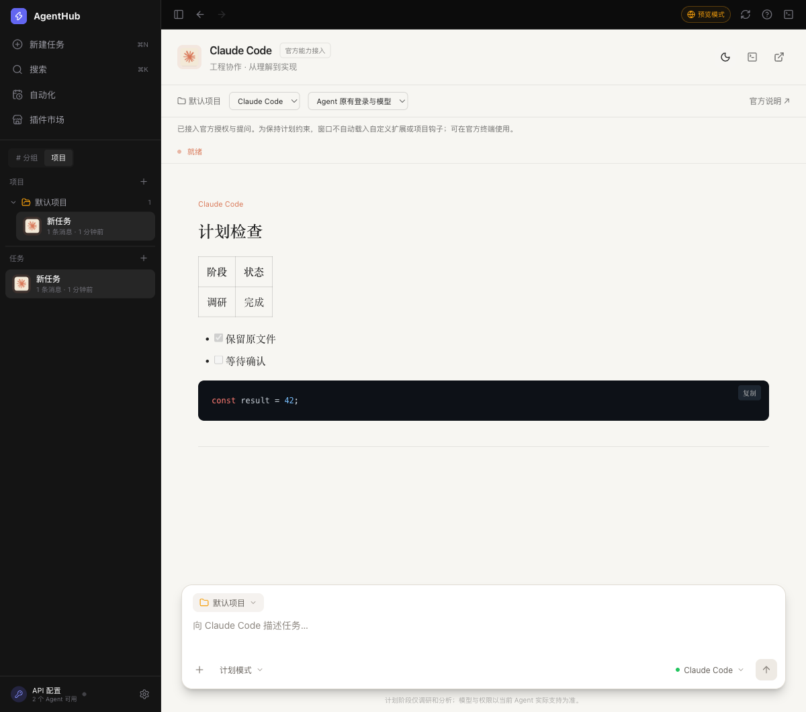
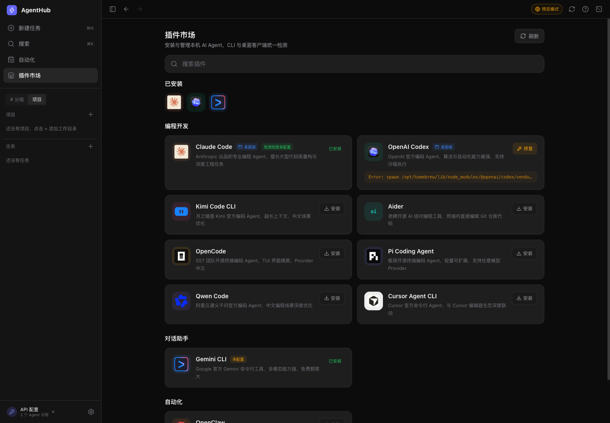
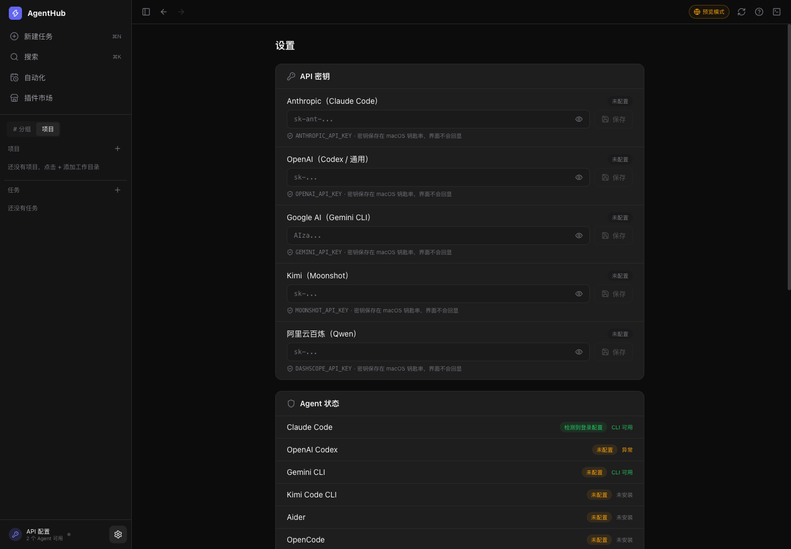

# AgentHub

<p align="center">
  
</p>

<p align="center">
  一个面向 macOS 的多助手工作台，可在同一窗口管理 AI 编程助手、按项目组织任务、审阅计划并继续历史会话。
</p>

<p align="center">
  <a href="README.en.md">English</a> · 简体中文
</p>

<p align="center">
  
  
  <a href="LICENSE"></a>
</p>

> [!IMPORTANT]
> 当前提供 v0.5.0 源码。桌面应用需在 macOS 上本地构建。

## 快速下载

| 平台 | 推荐下载 | 安装方式 |
| --- | --- | --- |
| macOS（Apple 芯片已验证） | [下载源码 ZIP](https://github.com/Jessica-yaoyao/AgentHub/archive/refs/heads/main.zip) | [从源码构建](#安装提示) |

## 界面预览

> 截图来自 v0.5.0 的界面演示，任务、安装状态和诊断信息均为示例。



<table>
  <tr>
    <td width="50%"></td>
    <td width="50%"></td>
  </tr>
  <tr>
    <td align="center">插件市场</td>
    <td align="center">设置与连接状态</td>
  </tr>
</table>

## 主要功能

- 将本机目录添加为项目，每个项目可以保留多项任务，不同助手的会话独立保存。
- 在插件市场浏览助手、检查安装和登录配置，并按助手提供的选项安装、修复或移除。
- 为任务选择助手和模型，按接入方式使用原有登录或 Kimi Code API。
- 在支持的接入中先读取和分析项目，确认计划后再执行文件修改。
- 停止当前运行并保留任务记录。重新打开应用后，支持恢复的助手可以从原任务继续。

## 任务计划与执行

1. 打开 AgentHub，在侧栏「项目」旁点击「+」，选择要工作的目录。
2. 在「插件市场」检查所需助手。如果该助手需要 API 密钥，在「设置」里配置服务。
3. 点击「新建任务」，选定项目、助手和可用模型。可以先用计划模式请助手阅读项目说明并列出三项整理建议。
4. 审阅计划后，确认执行或调整要求。点击停止可中断当前运行，之后可从侧栏回到原任务。

### 接入验证情况

| 助手 | 项目记录中的验证范围 |
| --- | --- |
| Kimi Code | 在工作台内使用官方界面。会话、计划确认、停止和恢复有真实调用记录。 |
| Codex、Claude Code、Pi | 使用 Kimi Code API 验证过任务运行、计划确认、停止和恢复。可按各助手的支持情况选择原有登录。 |
| Gemini CLI、Qwen Code、Cursor Agent、OpenCode、Aider、OpenClaw | 插件市场提供安装管理入口，完整任务流程仍待逐一验证。 |

终端入口和自动化任务各自有独立的执行规则。更多接入说明见 [项目状态](docs/STATUS.md)。

## 隐私边界

- 在设置中填写的 API 密钥保存在 macOS 钥匙串。
- 任务记录和应用设置保存在本机。
- 运行任务时，所选助手或模型服务按其接入方式处理任务内容。使用所需的账号、授权和额度由使用者提供。

## 安装提示

### macOS

需要 Node.js 22 或更新版本、npm、Rust 和 macOS 命令行开发工具。解压源码后，在项目目录执行下面两条命令。

```sh
npm ci
npm run tauri build -- --bundles app
```

构建完成后，在 `src-tauri/target/release/bundle/macos/` 打开 `AgentHub.app`。

## 本地开发

安装依赖后，可在浏览器预览演示界面，或启动桌面开发窗口。

```sh
npm run dev
npm run tauri dev
```

可用下面的命令检查任务会话、前端构建和桌面端代码。

```sh
npm test
npm run build
cargo test --manifest-path src-tauri/Cargo.toml
```

## 参与项目

提交改进时，请说明使用环境、复现步骤和验证结果。涉及助手接入的改动请写明助手和所用服务。

## 作者

- [Jessica-yaoyao](https://github.com/Jessica-yaoyao)
- [IronMan-libingxue](https://github.com/IronMan-libingxue)

完整署名见 [AUTHORS.md](AUTHORS.md)。

## 许可

原创代码与文档按 [PolyForm Noncommercial 1.0.0](LICENSE) 提供，允许符合条款的非商业使用、修改和分享。商业使用需另行取得授权。

第三方名称与标识归各自权利人所有，见 [品牌素材来源](public/brands/SOURCES.md)。
